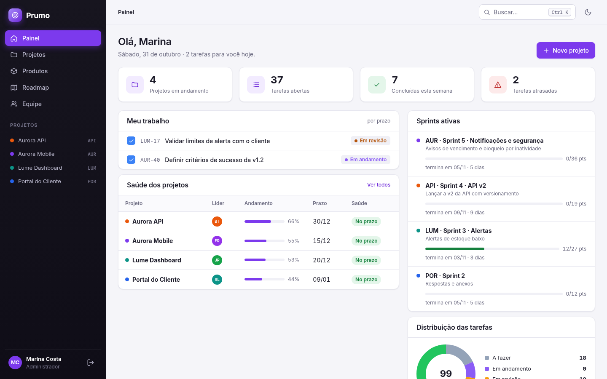
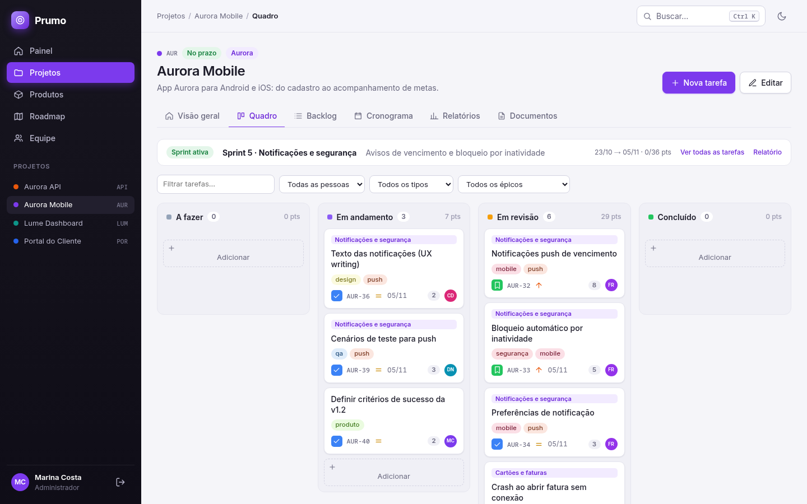
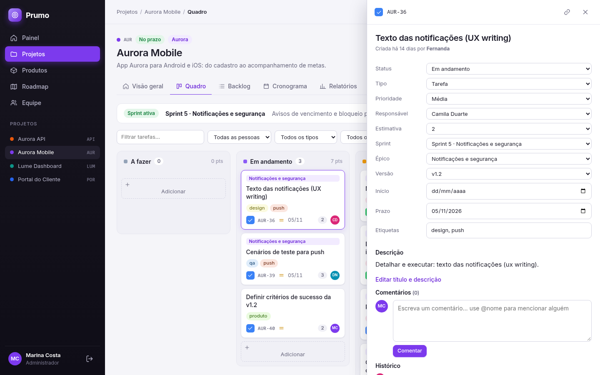
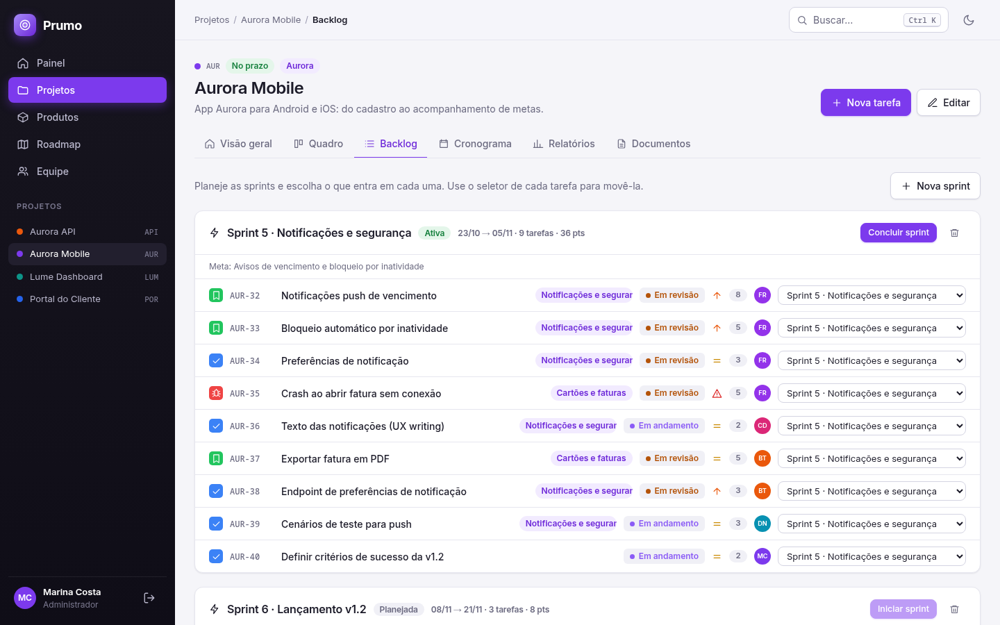
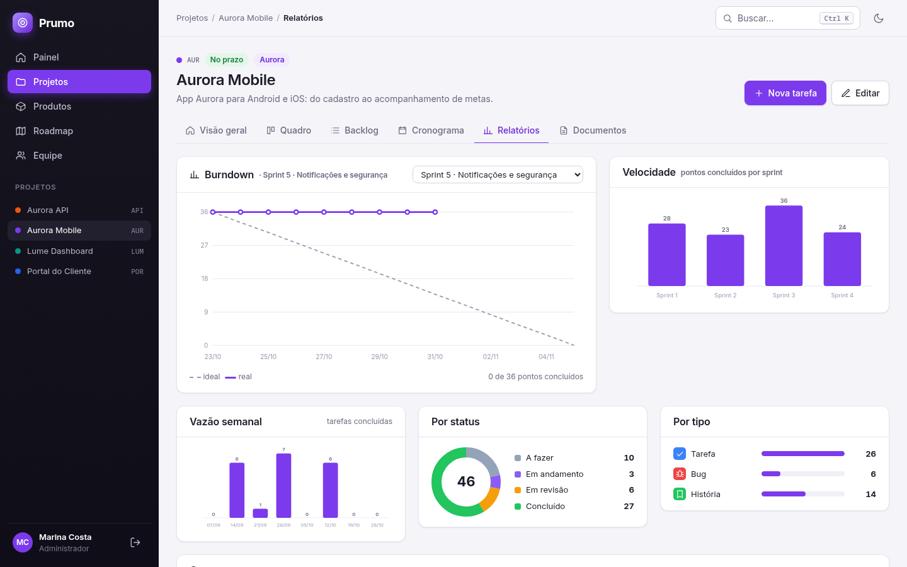
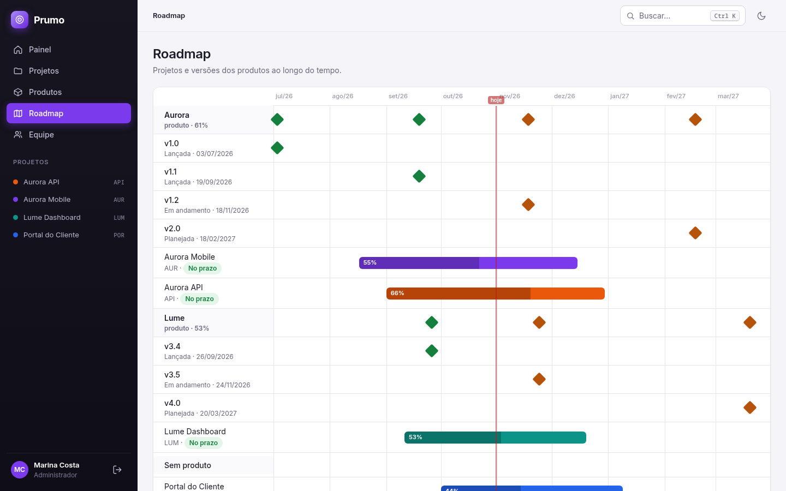
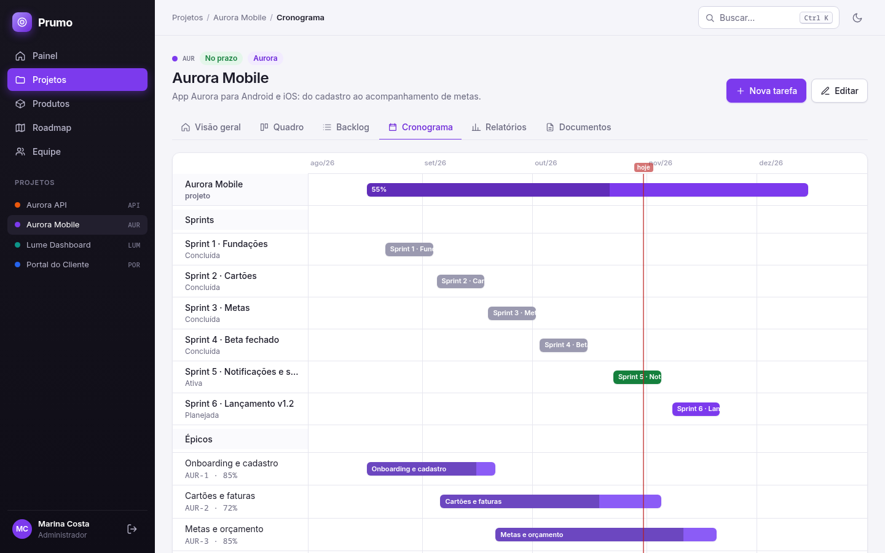
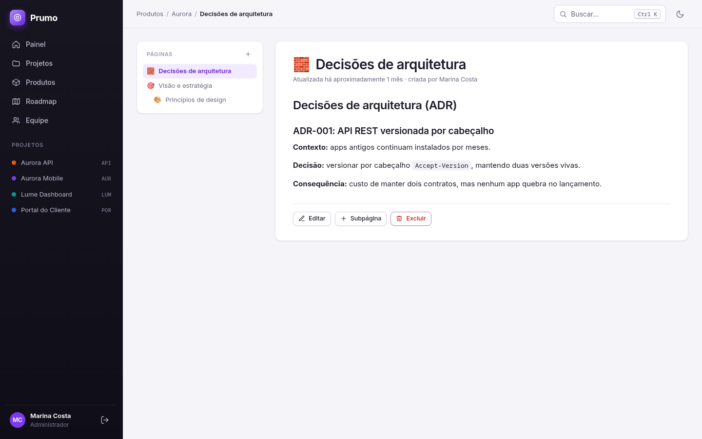
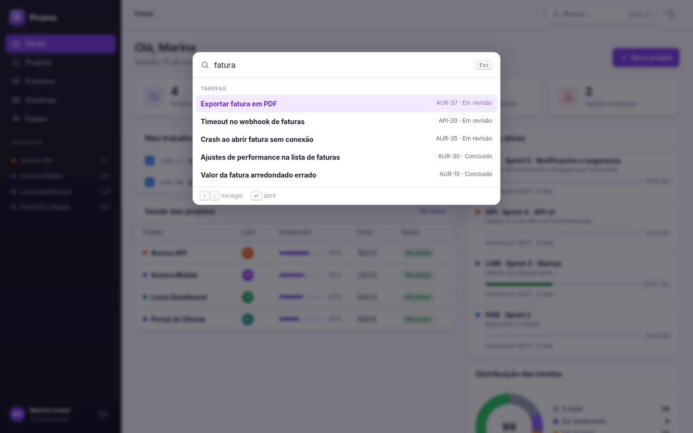

# Prumo

Gestão de **projetos e produtos** em um só lugar: quadro kanban, backlog com sprints, cronograma, relatórios, roadmap de produto e documentos em Markdown. É uma mistura de Jira (tarefas, sprints, burndown) com Notion (páginas ligadas a projetos e produtos), feita para **uma empresa/equipe**.

> Projeto de portfólio. Roda de verdade (regras, histórico, permissões, testes), mas não tem e-mail, SSO nem tempo real: o foco é mostrar um sistema completo e bem construído.



## O que tem

- **Painel** com o que é seu, o que está atrasado e a atividade recente da equipe.
- **Projetos** com chave própria (`WEB`, `API`…), tarefas numeradas (`WEB-12`), tipos (tarefa, bug, história, épico), prioridades e estimativas na escala 1, 2, 3, 5, 8, 13.
- **Quadro kanban** com arrastar e soltar (A fazer, Fazendo, Em revisão, Concluído), criação direta na coluna e filtros.
- **Gaveta da tarefa**: cada campo editado salva sozinho, comentários em Markdown com `@menções` e histórico completo de mudanças.
- **Backlog e sprints**: criar, iniciar e concluir sprints (só uma ativa por projeto); ao concluir, as pendências vão para a sprint escolhida.
- **Relatórios**: burndown por snapshot diário, distribuição por status e carga por pessoa (gráficos SVG gerados no servidor).
- **Cronograma** (Gantt em CSS) com sprints e marcos.
- **Produtos** que evoluem: backlog de produto, versões (releases) e **roadmap** da empresa; projetos entregam partes de um produto.
- **Documentos**: páginas em árvore ligadas a um projeto ou a um produto, com pré-visualização de Markdown ao vivo.
- **Busca global** (`Ctrl+K`) por tarefas, projetos, produtos, páginas e pessoas.
- **Papéis**: admin, membro e leitor (o leitor só visualiza; o servidor também bloqueia, não só a interface).
- Tema claro/escuro, responsivo (testado em 390 px) e em português.

| Quadro | Gaveta da tarefa |
| --- | --- |
|  |  |

| Backlog e sprints | Relatórios |
| --- | --- |
|  |  |

| Roadmap de produto | Cronograma |
| --- | --- |
|  |  |

| Documentos | Busca (Ctrl+K) |
| --- | --- |
|  |  |

Tema escuro e celular: [tema-escuro.png](docs/tema-escuro.png), [mobile.png](docs/mobile.png).

## Rodando

Precisa de **Ruby 4.0.9** (ver `.ruby-version`); o banco é SQLite, sem serviços externos.

```bash
bin/setup --skip-server   # instala gems, cria o banco e carrega os dados de demonstração
bin/rails server          # http://localhost:3000
```

Na tela de entrada há botões de **login de demonstração** (Marina é admin, Helena é leitora). Os usuários do seed usam a senha `prumo123`. Para desligar o login de demonstração, defina `DEMO_LOGIN=false`.

Para recriar os dados do zero: `bin/rails db:reset`.

### Dados de demonstração

O seed simula meses de trabalho (usa `travel_to`): 8 pessoas, 2 produtos (Aurora, Lume) com versões, 5 projetos, cerca de 110 tarefas, sprints concluídas, uma ativa no meio do ciclo e outra planejada, comentários, páginas e um histórico de mais de 400 eventos. Por isso o burndown e o painel já nascem com vida.

## Decisões de engenharia

- **Rails 8.1 puro**: Propshaft, importmap, Turbo e Stimulus, sem build de JavaScript e sem framework de front. A gaveta é um Turbo Frame; o kanban é um controller Stimulus com `fetch` para `PATCH /issues/:key/move`.
- **Ordenação por posição fracionária**: cada tarefa tem uma `position` decimal com intervalo de 1024. Mover um cartão grava só a linha dele (média entre os vizinhos), sem renumerar a coluna.
- **Histórico por callbacks**: mudanças em tarefas geram `Event`s em `after_commit`, com o autor vindo de `Current.user`. O seed evita uma transação única de propósito, para esses eventos existirem.
- **Burndown**: um `SprintSnapshot` por dia guarda o restante da sprint; o relatório desenha ideal vs. real a partir deles.
- **Busca segura**: `LIKE` com `ESCAPE` explícito (o SQLite não tem caractere de escape padrão), então `%` e `_` digitados pelo usuário não viram curinga.
- **Markdown seguro**: Redcarpet com `filter_html` e `safe_links_only`, mais `sanitize`; `<script>` e `javascript:` não passam.
- **Migração do legado**: o projeto original tinha tabelas simples (equipe, status em inglês). As migrations convertem tudo (status e prioridades, `team_members` virando usuários) e há teste de migração sobre um banco no formato antigo.
- **Permissões no servidor**: `require_editor!` e `require_admin!` nos controllers; `403` mesmo se alguém forçar a requisição.
- **Login**: `bcrypt`, `rate_limit` na entrada e `reset_session` ao autenticar.

## Qualidade

```bash
bin/rails test      # 76 testes: modelos e fluxos completos (login, permissões, sprints, migração)
bin/rubocop         # estilo (rails-omakase), sem ofensas
bin/brakeman        # análise de segurança, 0 avisos
```

A integração contínua (`.github/workflows/ci.yml`) roda Brakeman, auditoria do importmap, RuboCop e os testes. O fluxo também foi conferido ponta a ponta em navegador real: arrastar cartão e persistir, edição na gaveta, sprints, busca por teclado, tema, leitor sem permissão (inclusive com requisição forçada) e ausência de rolagem horizontal no celular.

## Estrutura

```
app/models        Product, Release, Project, Issue, Sprint, SprintSnapshot, Milestone,
                  Membership, Comment, Event, Page, User, Current
app/controllers   um por recurso, mais busca, painel e roadmap
app/helpers       ícones, avatares, Markdown e gráficos SVG
app/javascript    controllers Stimulus (board, drawer, palette, theme, markdown…)
app/assets        CSS separado em base, layout, components, board, docs e charts
db/seeds          simulação dos dados de demonstração
test/             modelos e testes de integração
```

## Fora do escopo (de propósito)

Convites por e-mail, SSO, anexos, permissões por projeto, tempo real e escala: são necessidades de produção, e este projeto é uma demonstração.
